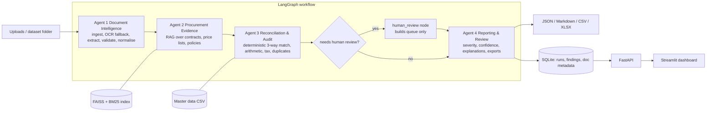

# ProcuraAI architecture

## Principles
1. **Deterministic core, LLM at the edges.** Every financial or rule decision is plain Python with `Decimal`. The LLM may (a) extract fields from messy documents and (b) explain findings that already exist. It cannot create, change, approve or suppress a finding, and it has no tools.
2. **Evidence or silence.** Contract/policy citations come only from indexed text and are re-verifiable (`KnowledgeBase.verify_citation`). If nothing relevant is retrieved, the report says so.
3. **Confirmed vs suspected.** Findings carry a status: `CONFIRMED` (rule/arithmetic failed against supplied evidence), `POTENTIAL`, `INSUFFICIENT_EVIDENCE`, `MANUAL_REVIEW`, `PASSED`. A missing delivery record or policy passage is never treated as proof of a violation. Nothing is labelled fraud.
4. **Untrusted documents.** Supplier/contract text is data. It is wrapped in `<untrusted_document>` tags for the LLM, scanned for instruction-like patterns, and never influences deterministic checks. Payment decisions remain human.
5. **Colab is only a dev environment.** `src/procuraai` has no Colab dependency; the notebook is a thin driver.

## Data flow

Nodes are wrapped for error handling: a failing node records the error and routes to the report node, so callers always get a (possibly partial) report. If LangGraph is unavailable a sequential orchestrator with the same node functions and state contract is used.

## Agent contracts (`AuditState`)
| Agent | Reads | Writes | LLM? |
|---|---|---|---|
| 1 Document Intelligence | `paths` or structured tables | `invoices`, `pos`, `dcs`, `extraction_log`, `normalization`, `ingestion_errors` | optional extraction (falls back, and says so) |
| 2 Procurement Evidence | invoices, POs | `evidence_context` (effective agreement, terms), `evidence_fn` | no (retrieval only) |
| 3 Reconciliation & Audit | invoices, POs, DCs, evidence_fn | `results` (typed findings with expected/observed/difference/evidence/exposure) | no |
| 4 Reporting & Review | results | `report`, `review_queue`, `output_files` | optional explanations (template fallback) |

## Ingestion and extraction
* PDFs: PyMuPDF text layer is used when a page has >= 40 characters; OCR (Tesseract) is applied **only** to image-only pages. Images: OCR. TXT/MD/CSV/XLSX: direct. ZIPs (nested) are extracted with zip-slip, size, count, depth and extension limits.
* Words are rebuilt into visual lines (same pipeline for PDF text and OCR). Large gaps become two spaces, used as field separators.
* Rule-based extractor (templates for 3 invoice layouts, 2 PO, 2 DC) parses table rows header-independently (robust to OCR noise). Provenance (file, page, excerpt, method, confidence) is stored per key field.
* OCR retry: up to 4 preprocessing variants; the pass with the best *self-consistency* (header fields present, lines sum to subtotal, totals foot) wins. Residual unreliability lowers `extraction_confidence`; findings from low-confidence invoices and from OCR-derived PO/DC evidence are **downgraded from CONFIRMED to POTENTIAL** and routed to review.
* Gemini path: schema-constrained JSON (`response_schema`), Pydantic re-validation, bounded retries with back-off, explicit `LLMUnavailable`/`LLMError`, token usage tracking.

## Matching (`normalization.py`)
Supplier: exact name -> alias -> tax id -> fuzzy (token-sort ratio; accept >= 90, review 75-90). Product: code -> alias -> fuzzy (token-set ratio on normalised descriptions, numeric-specification guard, margin test) -> optional semantic hook (never auto-accepted). Original and normalised values and candidate lists are kept in `MatchResult`.

## Audit engine (`audit/engine.py`)
Checks: supplier, PO/DC linking, currency, dates, product identity, duplicates (exact: supplier + OCR-folded invoice number; possible: same supplier + PO + same total/lines), agreement effectiveness (on **PO date**), three-way quantities (cumulative across invoices for the PO, aggregating several DCs), unit price vs contract, volume discount (on **ordered** quantity), line/header arithmetic, tax rate vs synthetic policy, additional charges vs agreement (incl. freight cap).
* Rounding: `ROUND_HALF_UP` to 0.01 at each step (gross, discount, tax). Tolerances (line 0.01, header 0.05, price 0, quantity 0, discount 0.01 pp) are in `AuditConfig`.
* **Exposure**: per-line exposure = (observed net + observed tax) - (supportable net + tax), where supportable uses `min(ordered, received)`, `min(billed, contract price)`, contractual discount and policy tax rate. All findings on a line share `exposure_key = LINE:n`; report totals count each key once per invoice. Header differences, unauthorized charges and duplicates have their own keys. Exposure is a *disputed amount*, never a confirmed saving; it is reported separately for confirmed and potential findings.

## RAG (`rag/kb.py`)
Section-aware chunking (size/overlap configurable; price schedules chunked by rows), metadata (file, doc type, supplier, section, page), embeddings, FAISS `IndexFlatIP` + BM25, dense/keyword/hybrid (RRF) retrieval with supplier/doc-type filters. Default embedder is an **offline TF-IDF lexical baseline**; `SentenceTransformerEmbedder` (local model, no paid API) is available but downloads weights from the Hugging Face hub on first use (not exercised in the sandbox that produced the reported numbers).

## API and storage
FastAPI + Pydantic schemas, SQLite via SQLAlchemy (document **paths and hashes**, run metadata, findings; no file contents). Optional `X-API-Key` (constant-time compare). Background execution for audits. Colab-hosted URLs are temporary.

## Commercial-deployment gap list (not done in this prototype)
Authentication/SSO (OIDC), role-based authorisation, **tenant isolation** (row-level security / per-tenant stores and indexes), encryption at rest and in transit, secrets manager, retention/deletion policies, backups and DR, API quotas and rate limiting, malware scanning of uploads, object storage for documents, job queue and workers for OCR, monitoring/alerting, audit logging, PII handling, model/LLM data-processing agreements, load testing, penetration testing, and validation on real (consented) documents. Do not call this production-ready.
